# Panduan Buleud Teu — Persiapan Database & Pemakaian Aplikasi

Diperbarui 5 November 2026 · versi aplikasi V40 / desktop 4.1

Buleud Teu memeriksa LJK pilihan ganda lewat HP, PC + scanner ADF, atau web. Semua data tersimpan di **satu Google Sheet milik sekolah**. Kunci keberhasilannya ada di persiapan database: kalau penulisan kelas di sheet **Guru**, **Siswa**, dan **Ujian** seragam, daftar siswa, OCR, dan analisis langsung bekerja.

## Ringkasan

| Komponen | Untuk apa | Cocok dipakai saat |
| --- | --- | --- |
| Google Sheet + Apps Script | Database sekolah: guru, siswa, ujian, hasil, analisis, bank soal | Disiapkan sekali oleh operator sekolah |
| Aplikasi web (PWA) | Buat ujian & kunci, cetak LJK, scan dengan kamera, analisis | HP/laptop apa pun, tanpa instalasi |
| Android (APK) | Scan cepat dengan kamera, OCR di HP | Menilai di kelas, satu per satu |
| Desktop Windows/Linux | Scan tumpukan LJK sekaligus dengan scanner ADF | Menilai puluhan–ratusan lembar |

Alur besarnya: operator menyiapkan sheet → guru membuat ujian dan kunci → mencetak LJK → siswa mengisi → guru memindai → hasil masuk sheet **HasilScan** → analisis butir → bank soal.

## 1. Menyiapkan spreadsheet & Apps Script (sekali, oleh operator)

Satu sekolah = satu spreadsheet. Semua guru memakai URL Web App yang sama.

1. Buat Google Sheet baru, misalnya “Buleud Teu — SMPN 2 Jalaksana”.
2. Buka **Ekstensi → Apps Script**. Hapus isi `Code.gs`, lalu tempel **seluruh** isi `apps-script/dist/BuleudTeu_lengkap.gs` dari repositori.
3. Klik **Layanan (+) → Drive API → Tambahkan**. Tanpa ini OCR identitas tidak jalan.
4. Simpan, pilih fungsi **`setup`**, lalu **Jalankan** dan setujui izin. Sheet `Sekolah`, `Guru`, `Siswa`, `Ujian`, `HasilScan`, dan `BankSoal` dibuat otomatis dengan judul kolom yang benar.
5. Isi ketiga sheet data (bagian 2 dan 3 di bawah).
6. **Terapkan → Deployment baru → Aplikasi web**: *Jalankan sebagai: Saya*, *Akses: Siapa saja*. Salin URL yang berakhiran `/exec`, lalu bagikan ke guru.
7. Di spreadsheet, menu **Buleud Teu → Tes koneksi & izin** menampilkan jumlah siswa, jumlah ujian, dan status Drive API.

Catatan penting:

- Akun `belajar.id` kadang tidak menyediakan pilihan “Siapa saja” karena dibatasi admin domain. Pasang di akun Gmail biasa bila begitu.
- Setiap kali kode Apps Script diganti: **Kelola deployment → Edit → Versi baru**. URL tetap sama.
- Judul kolom (baris 1) jangan diubah atau ditukar urutannya. Menu **Setup / perbaiki sheet** mengembalikannya bila rusak.
- Data guru/siswa yang baru diubah langsung terbaca. Di aplikasi cukup tekan **Muat ulang**.

## 2. Mengisi sheet Sekolah, Guru, dan Siswa

### Sheet Sekolah

Kolom A berisi label (sudah dibuat `setup`), kolom B diisi.

| Label (kolom A) | Contoh isi (kolom B) | Dipakai untuk |
| --- | --- | --- |
| Nama Sekolah | SMPN 2 Jalaksana | Kop LJK, dashboard, kaki aplikasi |
| NPSN | 20212974 | Identitas |
| Jenjang (SD/SMP/SMA/SMK) | SMP | Opsi bawaan: SD/SMP = ABCD, SMA/SMK = ABCDE |
| Alamat, Kota/Kabupaten | Jl. …, Kuningan | Kop LJK |
| Kepala Sekolah, NIP Kepala Sekolah | … | Laporan analisis |
| Tahun Pelajaran | 2026/2027 | Kop LJK, dashboard |
| Logo (ID file Google Drive) | ID atau link file logo | Logo di LJK dan aplikasi (PNG/JPG < 300 KB) |

### Sheet Guru

Satu baris per guru. Nama inilah yang dipilih saat masuk.

| Kolom | Contoh | Aturan |
| --- | --- | --- |
| Nama | Rizal Abdurrahman, S.Pd | Ditulis sama persis dengan yang dipilih saat login |
| Email | (boleh kosong) | Catatan saja |
| PIN | 1234 | 4 digit, diatur operator. 5 kali salah = kunci 10 menit |
| Mapel (pisah koma) | INFORMATIKA, IPA | Pakai nama baku (bagian 3) |
| Kelas (pisah koma) | 8A, 8B, 8C, 9A, 9B | **Nama rombel persis seperti di sheet Siswa** |
| Aktif | Ya | Tidak = tidak bisa masuk |

### Sheet Siswa

Bisa ditempel dari ekspor Dapodik. Satu baris per siswa.

| Kolom | Contoh | Aturan |
| --- | --- | --- |
| NISN | 0123456789 | Format teks (angka 0 di depan tidak hilang) |
| NIS | 2324101 | Boleh kosong |
| Nomor Peserta | 08101 | Yang ditulis siswa di LJK; membantu OCR |
| Nama | IBNU BIN LADEN | Nama lengkap, huruf besar disarankan |
| Kelas | **8A** | Nama rombel: tingkat + huruf (bagian 3) |
| Tingkat | 8 | Angka 7/8/9. Boleh kosong bila Kelas diawali angka |
| L/P | L | Boleh kosong |

### Aturan pencocokan kelas (penyebab “351 dari 548 siswa”)

Saat guru masuk, aplikasi **hanya menerima siswa dari kelas yang berkaitan dengan guru itu**, bukan seluruh sekolah. Ini disengaja: daftar pencarian lebih pendek dan OCR lebih tepat.

- Siswa ikut terkirim bila **Kelas**-nya tercantum di kolom *Kelas (pisah koma)* guru tersebut, **atau** di kolom *Kelas* salah satu ujian milik guru itu.
- Pencocokan memakai tulisan **persis sama** (huruf besar/kecil diabaikan). `8` tidak cocok dengan `8A`; `8 A` tidak cocok dengan `8A`; `VIII A` tidak cocok dengan `8A`.
- Ujian berkelas **SEMUA** memakai kolom *Tingkat*: semua siswa tingkat itu ikut.

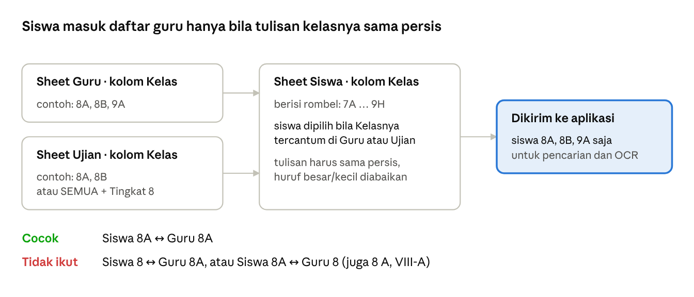

Pada data sekarang, guru Rizal menulis Kelas `8,9`, sehingga yang terkirim hanya siswa kelas 8 dan 9 (351 siswa). Kelas 7 tidak ikut. Agar semua 548 siswa muncul, cantumkan **semua rombel yang diajar** di kolom Kelas guru, misalnya `7A, 7B, …, 9H`. Lebih baik lagi, ubah kolom Kelas di sheet Siswa menjadi nama rombel (`8A`) dan isi kolom Tingkat (`8`).

## 3. Rekomendasi penamaan kelas, tingkat, dan mapel (SMP)

Gunakan satu pola yang sama di sheet Siswa, Guru, dan Ujian. Aplikasi mengubah semuanya ke huruf besar, tetapi spasi dan tanda baca tetap dihitung.

### Kelas (rombel) dan tingkat

| Isi | Rekomendasi | Hindari |
| --- | --- | --- |
| Kelas di sheet Siswa | `7A`, `7B`, … `8A` … `9H` (angka tingkat + huruf rombel, tanpa spasi) | `8`, `8 A`, `VIII-A`, `Kelas 8A`, `8.A` |
| Tingkat di sheet Siswa | `7`, `8`, `9` | `VII`, `Kelas 7`, kosong bila Kelas tidak diawali angka |
| Kelas di sheet Guru | Semua rombel yang diajar: `8A, 8B, 8C, 9A, 9B` | Hanya tingkat (`8,9`) bila sheet Siswa memakai rombel |
| Kelas ujian | Rombel yang ikut ujian, dipilih di aplikasi. Untuk satu angkatan: SEMUA + Tingkat | Mengetik manual dengan ejaan lain |

Alasannya: dengan rombel, analisis butir bisa per kelas (8A saja) maupun per tingkat (seluruh kelas 8), dan daftar siswa yang dicari guru jadi pendek. Kalau sekolah memakai kelas paralel bernomor (`8-1`, `8-2`), itu juga boleh asal **sama persis** di ketiga sheet.

### Nama mata pelajaran

Aplikasi mengelompokkan hasil, analisis, dan bank soal per **Mapel + Tingkat**. Satu mapel harus selalu ditulis sama oleh semua guru. Nama di bawah mengikuti struktur Kurikulum Merdeka SMP.

| Mapel (tulis persis begini) | Catatan |
| --- | --- |
| PENDIDIKAN AGAMA ISLAM | Agama lain: PENDIDIKAN AGAMA KRISTEN, … KATOLIK, … HINDU, … BUDDHA, … KHONGHUCU |
| PENDIDIKAN PANCASILA | Pengganti PPKn |
| BAHASA INDONESIA |  |
| MATEMATIKA |  |
| IPA | Ilmu Pengetahuan Alam |
| IPS | Ilmu Pengetahuan Sosial |
| BAHASA INGGRIS |  |
| PJOK | Pendidikan Jasmani, Olahraga, dan Kesehatan |
| INFORMATIKA |  |
| SENI MUSIK / SENI RUPA / SENI TARI / SENI TEATER | Tulis cabang seni yang diajarkan |
| PRAKARYA | Bila diselenggarakan |
| BAHASA SUNDA | Muatan lokal Jawa Barat |
| KODING DAN KECERDASAN ARTIFISIAL | Mapel pilihan, bertahap mulai kelas 7 sejak 2025/2026 ([Permendikdasmen 13/2025](https://www.detik.com/edu/sekolah/d-8021932/permendikdasmen-13-tahun-2025-isi-lengkap-dan-dampaknya-untuk-sekolah)) |

### Nama ujian

Pola yang disarankan: **jenis + semester/bab + mapel singkat**, misalnya `PSAS GANJIL IPA`, `PSTS GENAP MATEMATIKA`, `UH BAB 3 INFORMATIKA`. Tingkat dan kelas tidak perlu ditulis di nama karena sudah tersimpan di kolom sendiri.

### Kesalahan umum

- Kelas siswa `8` tetapi guru menulis `8A`, atau sebaliknya: siswa tidak muncul.
- Mapel `IPA` dan `ILMU PENGETAHUAN ALAM` dipakai bergantian: analisis dan bank soal terbelah dua.
- Nama guru diubah setelah ujian dibuat: ujian lamanya tidak tampil, karena kolom Guru di sheet Ujian masih memakai nama lama. Samakan keduanya.
- NISN/Nomor Peserta diformat angka sehingga nol di depan hilang. Jalankan **Setup / perbaiki sheet** untuk mengembalikan format teks.

## 4. Membuat ujian dan mencetak LJK

### Membuat ujian (web atau Android)

1. Beranda → **+ Ujian baru**.
2. Isi **Nama ujian** dan **Mapel** (pilih dari mapel yang diampu).
3. Pilih **kelas** yang ikut. Pilihan kelas diambil dari sheet Guru dan sheet Siswa.
4. Pilih **opsi**: ABCD (SD–SMP) atau ABCDE (SMA). Isi **KKTP** (bawaan 75).
5. Isi **kunci jawaban**: ketik (misalnya `ABCDA…`), ketuk di LJK digital, atau **scan LJK kunci** yang sudah diisi guru.
6. **Jumlah soal = panjang kunci** (1–50). Nomor LJK setelah itu diabaikan.

Ujian tersimpan di sheet **Ujian** dengan ID otomatis. Skor di HasilScan dihitung saat disimpan. Kalau kunci diubah belakangan, analisis butir memakai kunci baru tetapi skor yang sudah tersimpan tidak ikut berubah, jadi pastikan kunci benar sebelum memindai.

### Memilih template LJK

| Template | Soal | Opsi | Kapan dipakai | Berkas |
| --- | --- | --- | --- | --- |
| F4 bermarker ABCD | sampai 50 | A–D | SD dan SMP, semua jenis ujian | `LJK_F4_ABCD.pdf` |
| F4 bermarker ABCDE | sampai 50 | A–E | SMA/SMK | `LJK_F4_ABCDE.pdf` |
| F4 tanpa marker 20 soal | 20 | A–D | Tata letak LJK PSAS lama, 4 kolom × 5 baris | `LJK_F4_TANPA_MARKER_20_ABCD.pdf` |
| F4 tanpa marker 25 soal | 25 | A–D | Tata letak LJK PSAS lama, 5 kolom × 5 baris | `LJK_F4_TANPA_MARKER_25_ABCD.pdf` |

Template bermarker paling tahan foto miring, bayangan, dan kertas melengkung, karena empat kotak hitam di sudut menjadi patokan. LJK tanpa marker dikenali otomatis untuk ujian **≤ 25 soal ABCD**. Ujian 21–25 soal hanya membaca LJK 25.

Cara tercepat mencetak: kartu ujian → **Cetak LJK**. Kop sekolah, logo, nama ujian, dan tahun pelajaran terisi otomatis, dan varian yang cocok terpilih sendiri.

### Aturan cetak dan pengisian

- Kertas **F4/Folio 215 × 330 mm**, skala **100%** (bukan “fit to page”). Keempat kotak hitam harus tercetak utuh.
- Kotak isian identitas dicetak **merah muda**. Warna ini dihapus otomatis sebelum OCR, sehingga tulisan pulpen biru/hitam terbaca bersih. Jangan cetak hitam-putih kalau ingin OCR optimal.
- Siswa menulis **nama, nomor peserta, kelas** dengan huruf kapital, satu huruf per kotak.
- Bulatan dihitamkan **penuh** dengan pensil 2B atau pulpen gelap. Jawaban yang dihapus harus bersih; dua bulatan terisi ditandai kuning untuk dicek.
- Jangan menulis atau mencoret di sekitar kotak hitam sudut.

Contoh tampilan template (bagian atas):

**F4 bermarker ABCD (SD–SMP).** Empat kotak hitam di sudut, kotak identitas merah muda, 50 nomor dalam 5 kolom.

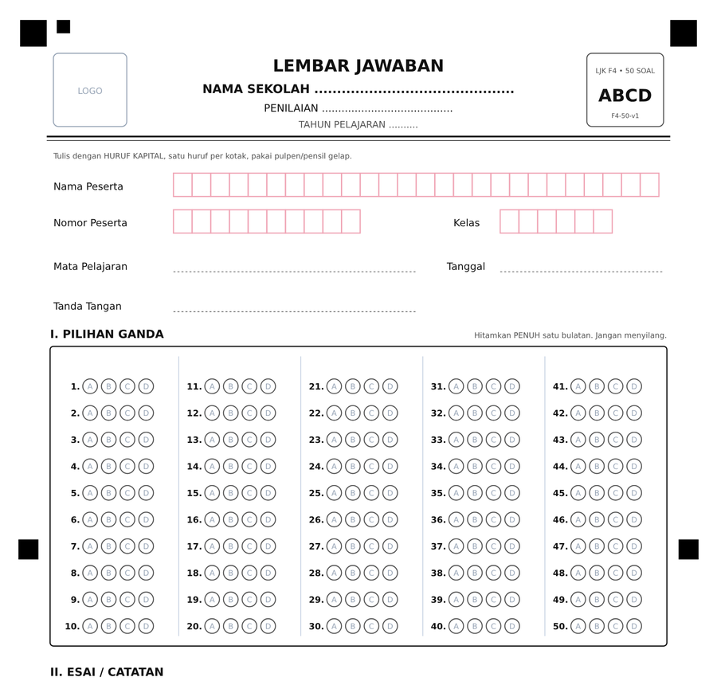

**F4 bermarker ABCDE (SMA).** Posisi marker dan nomor sama dengan ABCD; hanya ada opsi E.

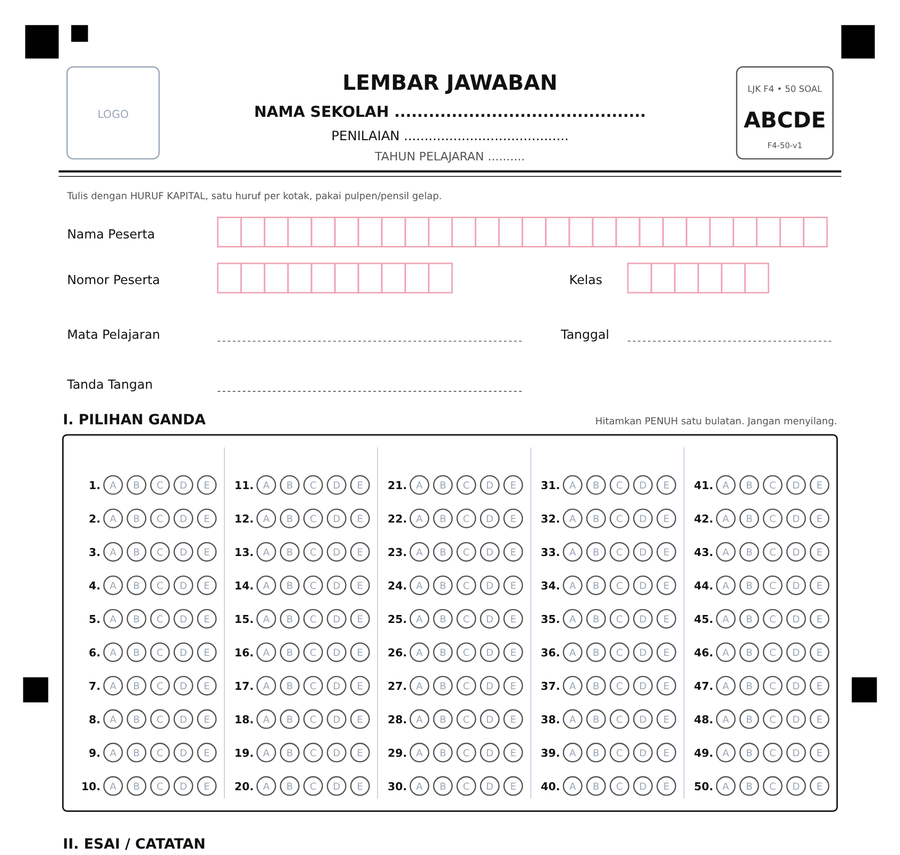

**F4 tanpa marker, 20 soal** (tata letak LJK PSAS, 4 kolom × 5 baris).

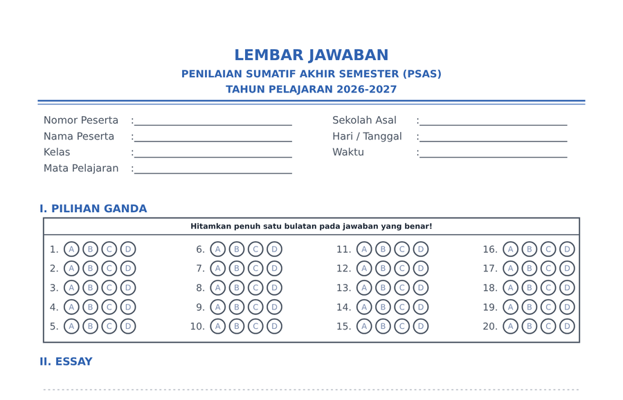

**F4 tanpa marker, 25 soal** (5 kolom × 5 baris).

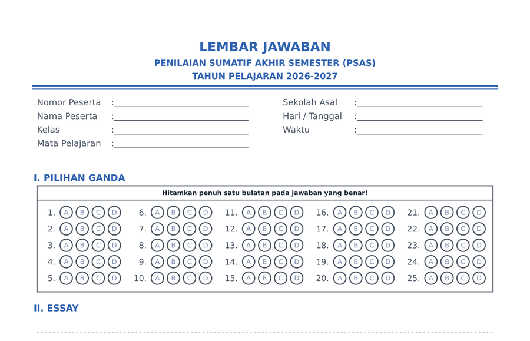

## 5. Memindai dan menyimpan hasil

### Masuk pertama kali (semua aplikasi)

1. Tempel **URL Web App** (`https://script.google.com/macros/s/…/exec`) dari operator.
2. Pilih **nama guru**, masukkan **PIN 4 digit**.
3. Beranda menampilkan nama dan logo sekolah, daftar ujian, dan jumlah siswa yang dimuat. Tekan **Muat ulang** setelah operator mengubah sheet.

### Web dan Android: satu lembar per foto

1. Kartu ujian → **Scan**. Arahkan kamera ke seluruh LJK. Bingkai menyala hijau (LJK lama: bulatan menyala) lalu foto diambil otomatis.
2. Periksa **LJK digital**. Nomor kuning = perlu dicek (dua jawaban atau isian tipis). Ketuk bulatan untuk mengoreksi.
3. **Identitas**: OCR membaca nama, nomor, kelas dan memberi **rekomendasi**. OCR tidak pernah memilih otomatis. Ketuk rekomendasi, atau cari nama (boleh salah ketik) dengan filter kelas.
4. **Simpan**. Saat offline, hasil masuk antrean dan dikirim otomatis begitu online.

Dari kiri: membuat ujian dan kunci, hasil scan dengan skor, identitas dengan rekomendasi OCR dan pencarian, analisis butir.

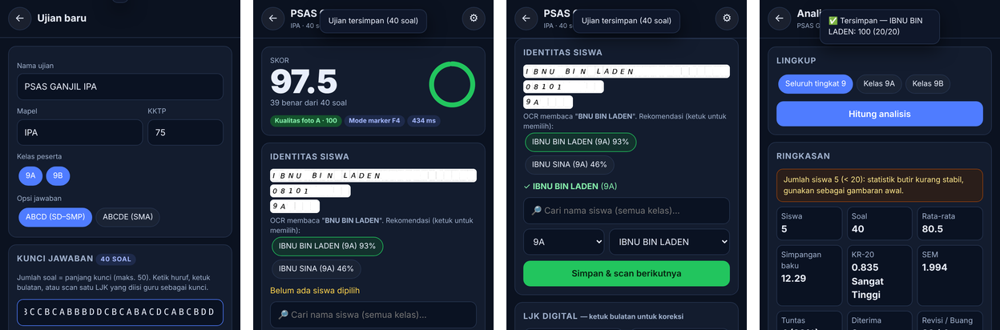

### Desktop + scanner ADF: satu tumpukan sekaligus

Cocok untuk 30–300 lembar. Pasang dari GitHub → Actions → *Desktop (Windows & Linux)* → artifact `buleud-teu-desktop-windows` (installer `.exe` atau `.zip` portabel). Di Windows, peringatan “Windows protected your PC” dilewati dengan **More info → Run anyway**.

| Sumber | Untuk scanner | Pengaturan |
| --- | --- | --- |
| WIA | Canon, Epson, Brother dengan driver Windows resmi | Pilih perangkat, DPI 200, centang Duplex bila perlu |
| Folder pantau | Semua scanner yang punya software sendiri (Epson Scan 2, Canon IJ Scan Utility, Brother ControlCenter, scan-to-folder) | Arahkan simpanan software scanner ke satu folder, pilih folder itu di aplikasi |
| TWAIN lewat NAPS2 | Driver yang ADF-nya hanya lewat TWAIN | Pasang NAPS2 (gratis) |
| SANE (Linux) | Scanner yang didukung `sane-utils` | Pilih perangkat |

Langkah:

1. Pilih **ujian** di kanan atas.
2. Masukkan tumpukan LJK ke ADF (boleh terbalik), pilih sumber, lalu **Mulai scan ADF** (atau **Mulai pantau folder**). Hasil scan PDF/TIFF/JPG lama bisa dimasukkan lewat **Impor berkas / folder**.
3. Setiap lembar masuk tabel: nilai, jumlah nomor yang perlu dicek, dan rekomendasi OCR.
4. Pilih siswa: ketik nama di **Cari siswa** lalu Enter (langsung lanjut ke lembar berikutnya), atau tekan **Terima rekomendasi ≥ 90%**.
5. **Simpan semua yang siap**. Sebelum menyimpan, aplikasi memperingatkan siswa dobel dalam satu batch, nomor kuning, dan siswa yang sudah pernah discan (hasil baru menggantikan yang lama).
6. **Ekspor CSV** menyimpan rekap batch ke berkas lokal.

Tampilan desktop setelah satu batch disimpan: tabel lembar (hijau = tersimpan), gambar bukti, LJK digital, dan identitas.

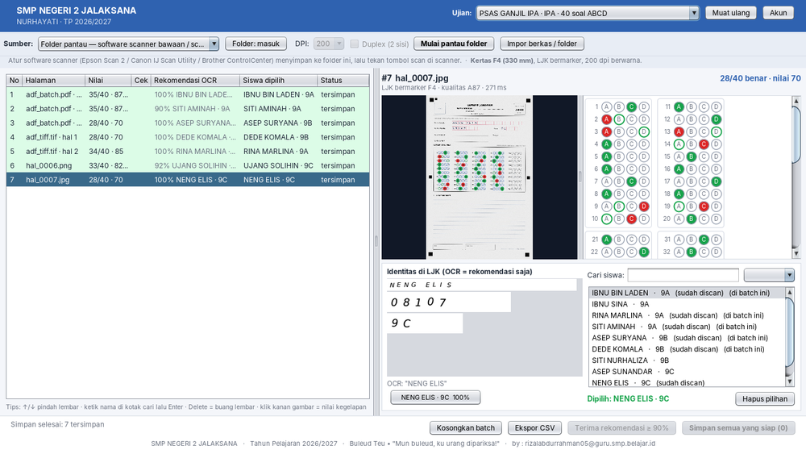

Saran pindai: **kertas F4, 200 dpi, berwarna**, panjang pindai 330 mm (bukan A4: marker bawah bisa terpotong).

## 6. Analisis butir dan bank soal

Kartu ujian → **Analisis**, lalu pilih lingkup: **seluruh tingkat** (misalnya semua kelas 8) atau **satu kelas** (8A). Lingkup per kelas hanya bisa dipakai bila sheet Siswa memakai nama rombel. Bila satu siswa dipindai lebih dari sekali, hasil terakhir yang dipakai.

Hasil analisis tampil sebagai **dashboard** (web dan Android):

1. **Ringkasan**: jumlah siswa dan soal, rata-rata (SD), ketuntasan, KR-20, SEM, jumlah butir **perlu ditinjau** dan **audit kritis**.
2. **Peta butir**: semua nomor sebagai ubin berwarna dengan kode teks (✓ Diterima, R Direvisi, ! Audit kritis, ? Data kurang), jadi tetap terbaca tanpa membedakan warna. Saring ke “Perlu ditinjau” atau “Audit kritis”, urutkan menurut P, D, atau r.
3. **Detail butir** (ketuk nomor): angka P, D, r, KR-20 jika dihapus; grafik setiap opsi untuk kelompok atas vs bawah (kunci disorot, pengecoh yang tidak berfungsi ditandai); alasan statistik; daftar **yang perlu dicek**; tombol **Ubah kunci** dan navigasi ke butir berikutnya.
4. **Tabel semua butir** tetap ada (dilipat) untuk dicetak atau disalin.

Alur yang disarankan: buka saringan **Audit kritis**, periksa kunci setiap nomor, lalu **Perlu ditinjau** untuk merevisi pengecoh. Untuk rapat MGMP, buat laporan dengan **mode anonim** (nama siswa diganti “Peserta 01…”).

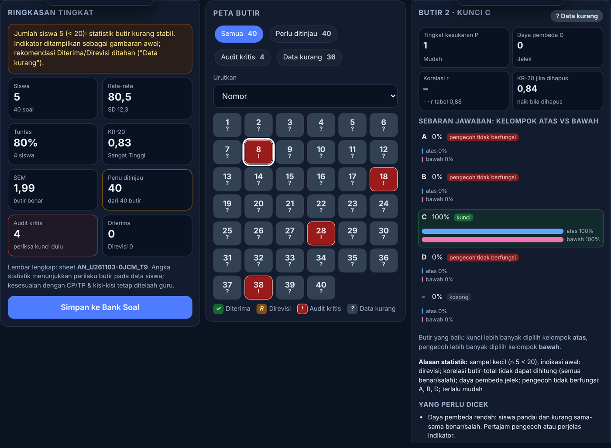

| Ukuran | Arti singkat |
| --- | --- |
| Tingkat kesukaran (P) | Proporsi siswa yang menjawab benar: sukar / sedang / mudah |
| Daya pembeda (D, 27%) | Selisih kelompok atas dan bawah: baik sekali / baik / cukup / jelek. Skor seri di batas kelompok dibagi berbobot, jadi hasilnya tidak bergantung urutan data |
| Korelasi butir-total (r terkoreksi) | Memadai bila r ≥ r tabel (α 0,05), Rendah bila di bawahnya, “–” bila tidak dapat dihitung. Ini bukti konsistensi internal, bukan validitas isi. |
| Reliabilitas KR-20 / KR-21 / SEM | Konsistensi tes; ada juga KR-20 jika butir dihapus |
| Efektivitas pengecoh | Berfungsi bila dipilih ≥ 5% siswa dan lebih banyak dipilih kelompok bawah daripada kelompok atas |
| Rekomendasi | Diterima / Direvisi / Audit kritis (D atau r negatif: periksa kunci, naskah, bukti scan) / Data kurang (n < 20), beserta alasannya. Tidak ada soal yang dibuang otomatis; keputusan akhir oleh guru |

Hasil ditulis ke sheet `AN_<ujian>_<lingkup>`. **Simpan ke Bank Soal** menyalin butir ke sheet **BankSoal**, dikelompokkan per Mapel + Tingkat. Kolom *Status Guru* (Pakai / Telaah / Revisi / Arsip; butir selain Diterima masuk sebagai Telaah) dan *Catatan* diisi guru.

**Validitas isi tetap tugas guru.** Angka statistik hanya menunjukkan bagaimana butir berperilaku pada data siswa. Kesesuaian soal dengan CP/TP, kisi-kisi, materi, level kognitif, dan bahasa harus ditelaah guru atau MGMP. Soal yang dijawab benar 95% siswa belum tentu jelek bila memang mengukur kompetensi dasar.

### Hak akses dan perlindungan data

- Hanya **guru pembuat ujian** yang dapat menyimpan hasil, menganalisis, mengirim ke bank soal, membuat laporan, mengubah, atau mengarsipkan ujian itu.
- Hasil hanya diterima untuk siswa yang **ada di sheet Siswa dan termasuk kelas ujian**. NISN dan nomor peserta diambil dari sheet Siswa. Dua siswa bernama sama di satu kelas wajib dibedakan dengan NISN.
- Kunci jawaban dengan karakter salah **ditolak** dan nomor posisinya disebutkan; KKTP harus 0–100.
- Guru yang diubah menjadi *Aktif: Tidak* langsung kehilangan akses, walau masih login.
- Kiriman ulang hasil scan yang sama (ScanID sama) memperbarui baris lama, tidak menambah baris ganda.
- Hasil antrean offline yang ditolak server (misalnya siswa tidak terdaftar) dilaporkan ke guru, tidak dicoba ulang selamanya.

## 7. Laporan nilai dan analisis (PDF, Excel, Google Sheet)

Laporan dibuat dari data yang **sudah tersimpan** di sheet HasilScan. Kalau satu siswa dipindai lebih dari sekali, scan terakhir yang dipakai. Ada dua jalan dengan hasil yang sama persis:

- **Dari aplikasi** (web, Android, desktop): kartu ujian → **Analisis** → kartu **Laporan**. Di desktop: tombol **Laporan…** di bawah.
- **Dari spreadsheet**: menu **Buleud Teu → 4. Buat laporan nilai / analisis (PDF, Excel)…**, lalu pilih ujian di dialog.

### Mode dan bagian

| Bagian | Simpel | Lengkap | Isi |
| --- | --- | --- | --- |
| Identitas ujian & kop | ✓ | ✓ | Nama sekolah, ujian, mapel, kelas/tingkat, jumlah soal, KKTP, guru |
| Daftar nilai | ✓ | ✓ | Nama, kelas, nomor peserta, jumlah benar, skor, tuntas, peringkat |
| Pilihan jawaban per nomor | ✓ | ✓ | Baris kunci + pilihan tiap siswa: hijau benar, merah salah, abu kosong |
| Rekap & ketuntasan | ✓ | ✓ | Rata-rata, tertinggi/terendah, median, simpangan baku, jumlah tuntas |
| Statistik tes |  | ✓ | KR-20, KR-21, SEM, r tabel, rekap rekomendasi butir |
| Analisis butir |  | ✓ | P, tingkat kesukaran, D, daya pembeda, r pbis, valid, KR-20 jika dihapus, rekomendasi + alasan |
| Sebaran & pengecoh |  | ✓ | Persentase tiap opsi, pengecoh berfungsi / tidak |
| Matriks benar/salah |  | ✓ | Tabel 0/1 siswa × butir |
| Tanda tangan | ✓ | ✓ | Kepala sekolah (nama + NIP dari sheet Sekolah) dan guru mapel |

Mode hanya mengisi centang bawaan. Setiap bagian bisa dicentang atau dilepas sendiri. Contoh: hanya **Analisis butir** untuk rapat MGMP, atau hanya **Daftar nilai** untuk diserahkan ke wali kelas.

### Pilihan lain

- **Lingkup**: seluruh peserta ujian atau satu kelas (mengikuti pilihan lingkup di layar analisis).
- **Urutan siswa**: kelas lalu nama, nama, atau skor tertinggi.
- **Mode anonim**: nama siswa diganti “Peserta 01…”, nomor peserta dikosongkan (untuk rapat MGMP atau presentasi).
- **Format**: **PDF** kertas F4 (mendatar otomatis bila tabel lebar), **Excel (.xlsx)**, atau **Google Sheet** saja.
- Setiap laporan juga diarsipkan sebagai Google Sheet di folder Drive **Buleud Teu — Laporan** milik pemilik spreadsheet sekolah. Bila kolom Email guru diisi, arsip itu otomatis dibagikan (hanya lihat) ke email tersebut.

Kartu Laporan di aplikasi web (Android dan desktop memakai pilihan yang sama):

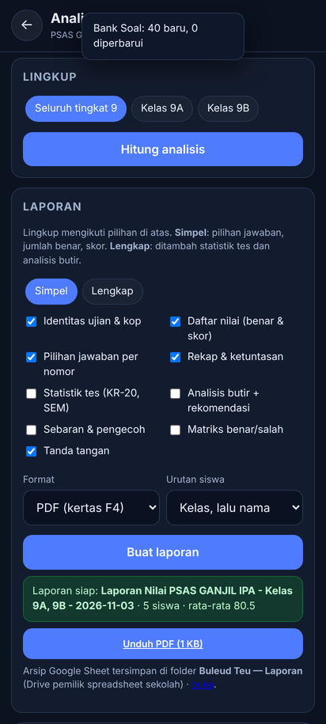

Contoh laporan **simpel** (tab Nilai): kop, identitas, rekap, kunci + pilihan jawaban berwarna, benar, skor, tuntas, peringkat, tanda tangan.

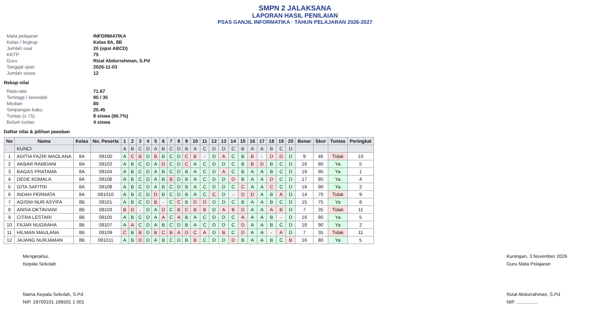

Contoh bagian **lengkap** (tab Analisis Butir): ringkasan statistik tes dan analisis per butir, diwarnai sesuai rekomendasi.

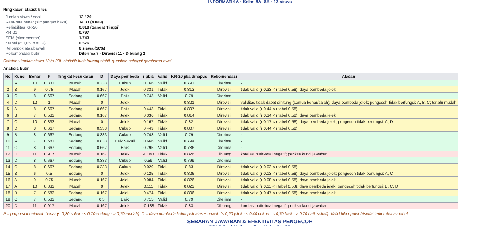

Setelah memasang kode versi ini, operator perlu menjalankan **Buleud Teu → Tes koneksi & izin** sekali dan menyetujui izin baru (akses URL eksternal untuk ekspor PDF/Excel). Lalu buat **versi baru** deployment Web App. Contoh hasil: [laporan simpel](contoh/contoh_laporan_simpel.pdf) dan [laporan lengkap](contoh/contoh_laporan_lengkap.pdf) (data contoh).

## 8. Pemecahan masalah

| Gejala | Penyebab paling mungkin | Solusi |
| --- | --- | --- |
| Jumlah siswa lebih sedikit dari data sekolah | Kelas guru tidak mencakup semua rombel, atau ejaan kelas berbeda | Lengkapi kolom Kelas guru; samakan ejaan (bagian 2 dan 3) lalu Muat ulang |
| Siswa tertentu tidak bisa dicari | Kelasnya tidak termasuk kelas guru/ujian | Tambahkan kelas itu ke ujian atau ke sheet Guru |
| “Server membalas halaman, bukan data” | Web App belum diakses “Siapa saja” | Deploy ulang dengan akses Siapa saja |
| OCR tidak membaca | Drive API belum ditambahkan, atau LJK dicetak hitam-putih | Tambahkan Drive API; cetak berwarna |
| LJK tidak terdeteksi | Marker terpotong, foto terlalu jauh/gelap, atau cetak tidak 100% | Cetak ulang skala 100%; foto lebih dekat dan terang |
| Scanner ADF hanya memindai A4 | Driver memakai ukuran bawaan | Pakai Folder pantau dengan ukuran Legal/F4 di software scanner |
| “Sesi berakhir, silakan masuk lagi” | Token login berlaku 6 jam | Masuk lagi dengan PIN |

Dua gejala lain di analisis dan laporan:

- **“Ekspor PDF/Excel gagal (401/403)”** berarti izin baru belum disetujui. Jalankan **Tes koneksi & izin** di spreadsheet, setujui, lalu buat versi baru deployment.
- **r pbis, D, dan KR-20 tampil “–”** terjadi bila semua siswa memperoleh skor total sama (misalnya 4 siswa sama-sama benar 6). Statistik itu memang tidak terdefinisi; analisis baru bermakna bila skor siswa bervariasi, idealnya ≥ 20 siswa.

Pesan penolakan dari server:

| Pesan | Artinya | Yang dilakukan |
| --- | --- | --- |
| Ujian ini milik guru lain | Guru mencoba memakai ujian yang dibuat guru lain | Masuk dengan akun pembuat ujian, atau buat ujian sendiri |
| Siswa … tidak ada di sheet Siswa | Nama belum terdaftar | Tambahkan siswa di sheet Siswa, Muat ulang, simpan lagi |
| Siswa … bukan peserta ujian ini | Kelas siswa tidak termasuk kelas ujian | Tambahkan kelas itu ke ujian, atau pilih siswa yang benar |
| Ada lebih dari satu siswa bernama … | Nama kembar di kelas yang sama | Isi NISN kedua siswa di sheet Siswa |
| Kunci tidak sah: nomor … | Ada karakter selain A–D/A–E | Perbaiki huruf di nomor yang disebut |
| Akun guru tidak aktif | Kolom Aktif guru = Tidak | Operator mengaktifkan kembali bila perlu |

## Distribusi aplikasi Android ke guru

- **Link unduhan tetap** (selalu versi terbaru): https://github.com/tomrzetd/buleud-teu/releases/latest/download/BuleudTeu.apk — bagikan lewat grup WhatsApp guru atau QR code.

  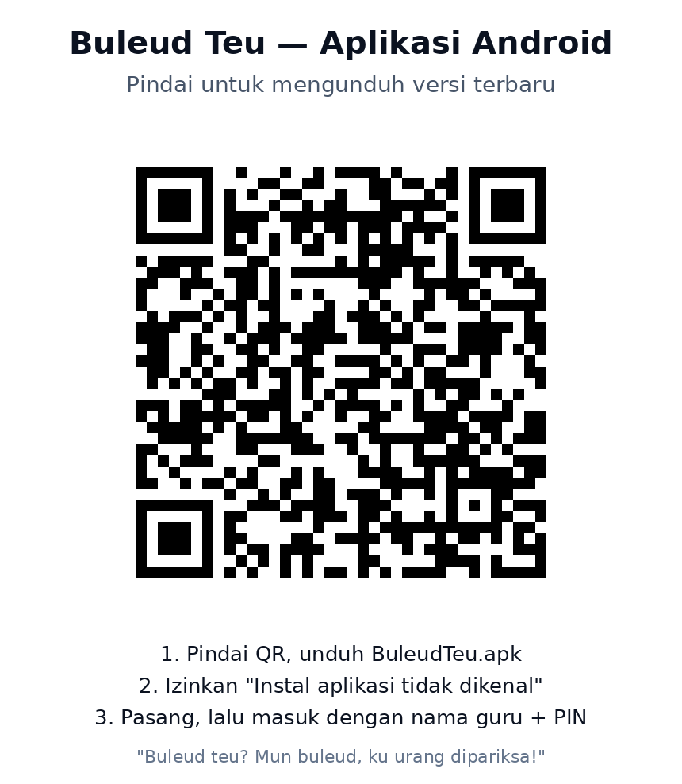

  Poster QR di atas siap dicetak atau dikirim ke grup WhatsApp; isinya selalu mengarah ke versi terbaru.
- Saat memasang pertama kali, Android meminta izin **Instal aplikasi tidak dikenal** untuk WhatsApp/Chrome/File. Bila Play Protect memberi peringatan, pilih **Detail lainnya → Tetap instal**.
- APK ditandatangani **kunci rilis Buleud Teu** yang tetap, sehingga versi baru **langsung menimpa** versi lama tanpa menghapus login, pengaturan, dan antrean hasil.
- Aplikasi memberi tahu bila ada versi baru di beranda (**Versi baru tersedia → Unduh pembaruan**). Tombol hanya aktif bila antrean hasil offline sudah terkirim.
- **Pindah dari APK debug (versi uji lama):** satu kali saja, kirim dulu antrean hasil, lalu **hapus aplikasi lama** dan pasang APK rilis. Setelah itu tidak perlu lagi.
- Operator menerbitkan versi baru: GitHub → **Actions → Android APK → Run workflow** (centang *Terbitkan*). Rilis muncul di halaman **Releases** dengan nomor versi `4.1.N`.

## 9. Daftar periksa operator

- [ ] Apps Script V40 terpasang, Drive API aktif, `setup` dijalankan
- [ ] Web App di-deploy (Saya, Siapa saja) dan URL dibagikan ke guru
- [ ] Sheet Sekolah lengkap, termasuk logo dan tahun pelajaran
- [ ] Sheet Siswa: Kelas berbentuk rombel (`8A`), Tingkat terisi, NISN berformat teks
- [ ] Sheet Guru: setiap guru punya PIN, mapel baku, dan **semua rombel yang diajar**
- [ ] Tes koneksi menunjukkan jumlah siswa sesuai data sekolah (misalnya 548)
- [ ] Uji coba: satu ujian, cetak 2 LJK, scan, cek baris di HasilScan
